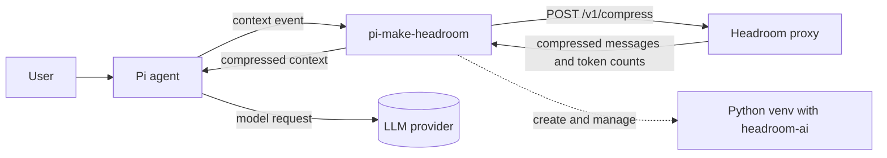

# Architecture

`pi-make-headroom` is a Pi extension that compresses the model context through a locally managed [Headroom](https://pypi.org/project/headroom-ai/) proxy. Pi still sends the request to its configured provider; the extension only replaces the message list for that request.

## System context

- **Pi** owns the session, tools, provider transport, and prompt assembly.
- **The extension** owns the venv, pinned install, proxy lifecycle, message conversion, and footer counters.
- **Headroom** is a local compression service. `/v1/compress` runs the compression pipeline without calling an LLM.

## Lifecycle

### Startup

1. `session_start` resets session counters and schedules setup in the background. It does not await setup.
2. Setup finds Python, creates or repairs the venv, installs the pinned version, starts the proxy, and waits for `/health` plus the optional Kompress warmup.
3. Until the proxy is ready, `context` returns the original transcript. The agent remains usable.
4. When setup finishes, the extension marks the proxy online and compresses the next request.

### Request path

1. Pi fires `context` with a copy of the provider-neutral transcript.
2. `convertToLlm` converts custom Pi messages to provider messages.
3. `piToOpenAI` converts them to the OpenAI shape expected by Headroom.
4. `HeadroomClient.compress` calls `POST /v1/compress` with the active model id.
5. `openAIToPi` aligns the compressed response with the original messages.
6. If alignment is unsafe, the extension returns the original transcript for that request.
7. Token counters update and the compressed list is returned for this request only. Session history is unchanged.

### Shutdown and cancellation

- `session_shutdown`, `/headroom off`, `/headroom stop`, `/headroom restart`, and `/headroom reinstall` cancel an in-flight setup.
- Cancellation invalidates the run id, kills the active pip/venv/proxy process tree, and releases `install.lock`.
- A healthy proxy left by a previous Pi process can be adopted. Explicit stop or restart kills it by recorded pid.

## Modules

| Module | Responsibility | Does not |
|--------|----------------|----------|
| `src/index.ts` | Pi events, lazy setup state, generation/attempt guards, commands, footer status. | Do message conversion or process management. |
| `src/proxy-manager.ts` | Python detection, venv creation, pinned pip install, proxy spawn/health/adoption, cancellation, locks, process trees. | Parse model messages. |
| `src/headroom-client.ts` | `/health` and `/v1/compress` HTTP calls, typed errors, timeouts, retries. | Know about Pi message types. |
| `src/format-bridge.ts` | Pi provider messages to OpenAI compression format and back. | Do I/O or mutate session state. |
| `src/ui.ts` | Footer text, token formatting, baseline/sent/saved percentages. | Read files or call the proxy. |
| `src/types.ts` | Local OpenAI, compression, and session types. | Import the host package at runtime. |

Detailed source rules are in [`src/AGENTS.md`](../src/AGENTS.md).

## Message alignment invariants

Headroom's live-zone compression operates on content inside messages and preserves the message count and roles. The bridge still treats alignment defensively:

- If the compressed list has a different length or role order, return the original transcript.
- Preserve tool call ids, tool result ids, tool names, thinking blocks, images, timestamps, usage, and provider fields from the original message.
- Replace only the text the model reads.
- Never send a partially aligned transcript.

## Failure modes

| Failure | Behavior |
|---------|----------|
| Python or pip missing | Setup fails; the footer shows offline; `/headroom reinstall` retries. |
| pip install fails or times out | The install log records the output; the original transcript is still used. |
| Proxy does not become healthy | Setup fails; the proxy process is killed. |
| Proxy crashes mid-session | The next request falls back to the original transcript and one restart is attempted. |
| Compression times out | That request is sent uncompressed; the proxy stays online. |
| Alignment fails | That request is sent uncompressed and a warning is shown once. |
| Session changes during setup | The stale run is invalidated, its process tree is stopped, and no result is published. |

## Security and privacy

- The proxy binds loopback (`127.0.0.1`); `/v1/compress` is loopback-only.
- The extension sets `HEADROOM_TELEMETRY=off`, `HEADROOM_BEACON=off`, and `DO_NOT_TRACK=1` unless the user overrides them.
- Untrusted values are passed to `spawn` as arguments, never interpolated into a shell command.
- The extension does not log prompts, message content, API keys, or proxy tokens.
- The managed venv is dedicated to this extension and is never installed into the system Python.

## Decisions

- [ADR 0001: Compress through the `context` hook](adr/0001-context-hook-compression.md)
- [ADR 0002: Managed pinned Python venv](adr/0002-managed-pinned-venv.md)
- [ADR 0003: Lazy background setup](adr/0003-lazy-background-setup.md)

## Testing

- `npm test` runs the `node:test` suites.
- Tests are offline and do not require a live proxy.
- Process and venv tests use a temp `HEADROOM_HOME`.
- CI runs `npm test`, a module import check, and `npm pack --dry-run` on Node 22 and 24.
